## Contribution Activity

<!-- Glowing line graph (like your first screenshot). No workflow needed. -->

## Stats

## Snake

<!-- Needs the GitHub Action in snake.yml (see below). Remove if you skip it. -->
<picture>
  <source media="(prefers-color-scheme: dark)" srcset="https://raw.githubusercontent.com/YOUR-USERNAME/YOUR-USERNAME/output/github-contribution-grid-snake-dark.svg"/>
  
</picture>

## Featured Projects

| Project | What it does |
|---|---|
| **Brute-force Log Analyzer** | Detects login brute-force attempts from auth logs |
| **Job Application Tracker** | Full-stack app to track applications and statuses |

## Tech

<!--
SNAKE WORKFLOW: save as .github/workflows/snake.yml in your profile repo

name: Generate Snake
on:
  schedule: [{ cron: "0 */12 * * *" }]
  workflow_dispatch:
  push: { branches: [main] }
permissions:
  contents: write
jobs:
  generate:
    runs-on: ubuntu-latest
    steps:
      - uses: Platane/snk/svg-only@v3
        with:
          github_user_name: ${{ github.repository_owner }}
          outputs: |
            dist/github-contribution-grid-snake.svg
            dist/github-contribution-grid-snake-dark.svg?palette=github-dark
      - uses: crazy-max/ghaction-github-pages@v3.1.0
        with:
          target_branch: output
          build_dir: dist
        env:
          GITHUB_TOKEN: ${{ secrets.GITHUB_TOKEN }}
-->
